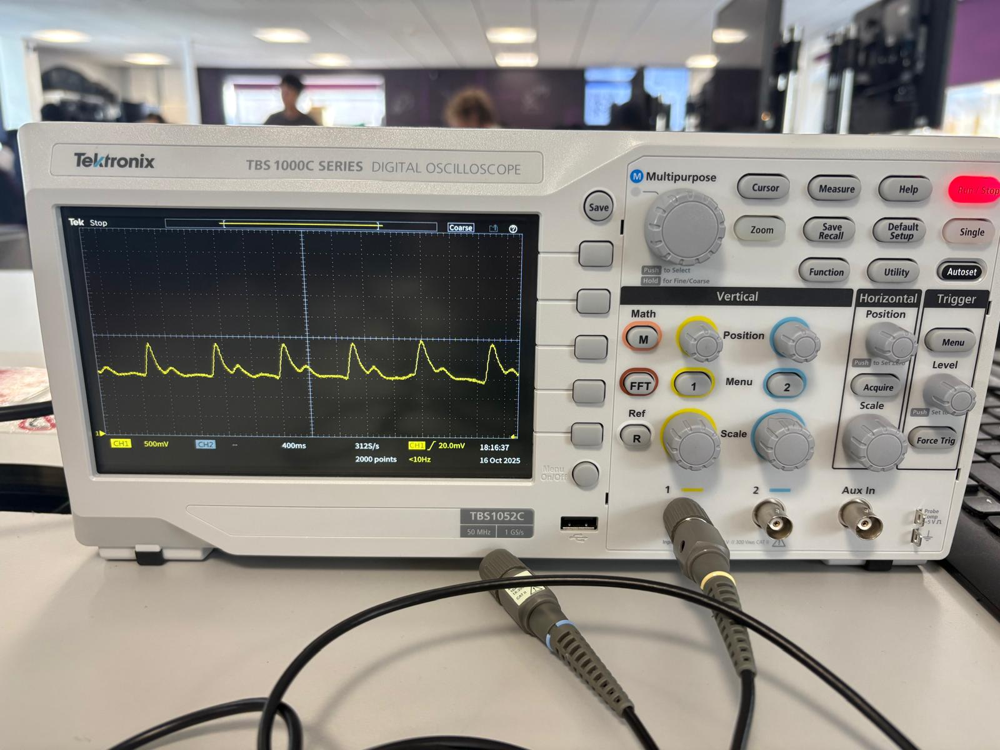
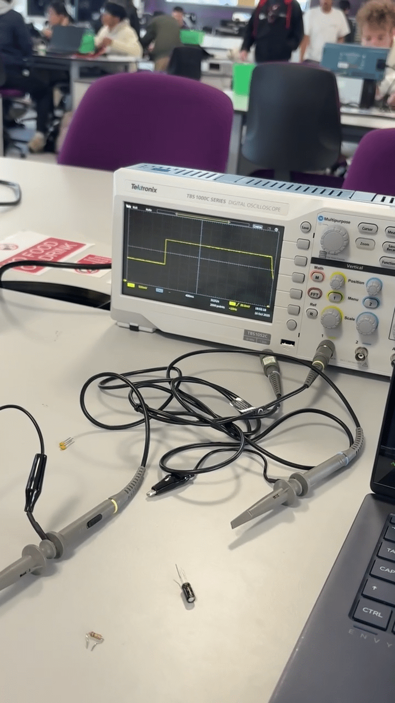
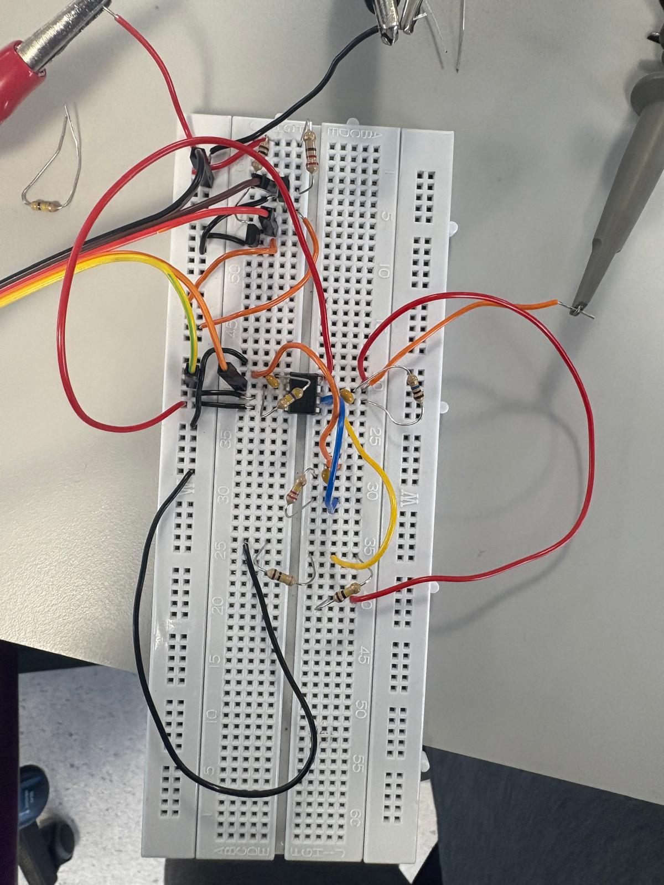
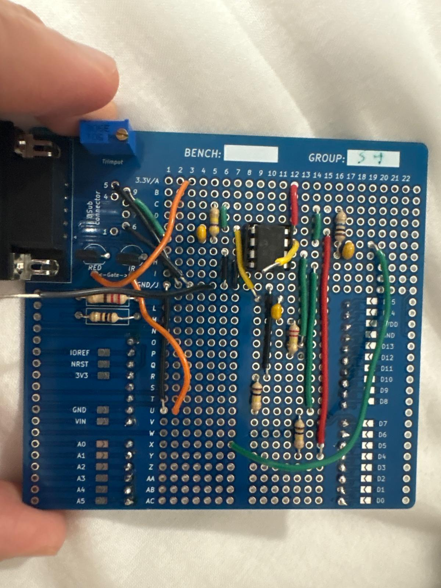
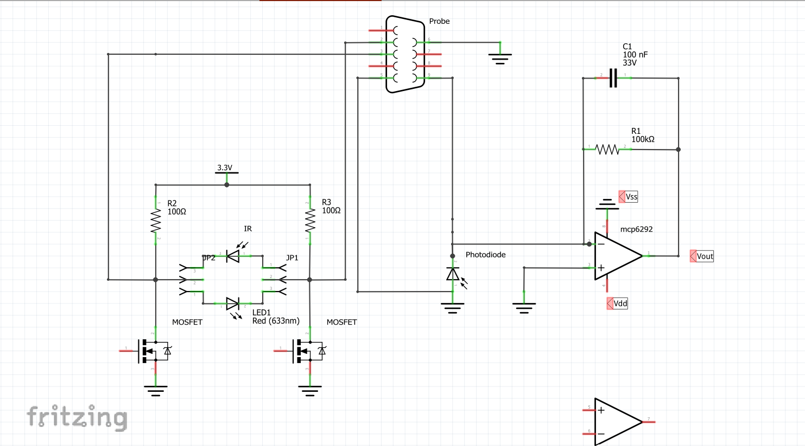

# PPG Pulse Signal Acquisition

## Project Overview

This project focuses on the construction and testing of an analogue photoplethysmography (PPG) circuit to acquire a pulse waveform using a pulse oximeter probe.

The circuit uses red and infrared light, a photodiode and analogue signal-conditioning circuitry to detect variations in light absorption associated with pulsatile blood flow.

The project involved LED driver testing, breadboard prototyping, circuit layout planning, PCB assembly and oscilloscope measurements.

## Demonstration

### PPG Waveform — Oscilloscope

Oscilloscope capture showing the acquired PPG signal with a repeating pulse waveform.

### Live PPG Signal

Animated recording demonstrating the PPG waveform during practical testing.

## Hardware

- Pulse oximeter probe with red and infrared LEDs and photodiode
- MCP6292 operational amplifier
- MOSFETs for LED switching
- Current-limiting resistors
- Feedback resistor and capacitor
- Additional resistors and capacitors
- Adjustable trimmer resistor
- Breadboard and prototype PCB
- 3.3 V supply
- Tektronix digital oscilloscope

## How It Works

1. The LED driver circuit controls illumination from the red and infrared LEDs inside the pulse oximeter probe.
2. Light passes through the fingertip and is detected by the photodiode.
3. Changes in arterial blood volume cause variations in the detected light intensity.
4. A transimpedance amplifier converts the photodiode current into a voltage signal.
5. Analogue signal conditioning helps prepare the pulsatile component for measurement.
6. The resulting PPG waveform is observed using an oscilloscope.

## Circuit Construction

The LED driver circuit was initially tested on a breadboard using red and green indicator LEDs to verify the switching paths.

The analogue signal acquisition circuit was subsequently assembled on a breadboard using the MCP6292 operational amplifier and passive components.

### Breadboard Prototype

### PCB Implementation

A component layout was prepared to support transferring the circuit onto a prototype PCB.

### Circuit Schematic

Fritzing schematic illustrating the red and infrared LED driver circuits, MOSFET switching stages, photodiode and MCP6292 transimpedance amplifier.

The editable Fritzing file is included in the project documentation.

## Results

Oscilloscope testing produced a visible, repeating PPG waveform with identifiable pulse peaks.

The oscilloscope photograph and animated recording demonstrate the acquisition of a pulsatile signal using the constructed analogue circuitry.

## Documentation

Detailed construction photographs, LED driver testing evidence, circuit layouts, the editable Fritzing schematic and oscilloscope recordings are available in the [project documentation](docs/README.md).

## Skills Demonstrated

- Analogue circuit design and prototyping
- LED driver circuit testing
- Photodiode signal acquisition
- Transimpedance amplifier implementation
- Analogue signal conditioning
- PCB assembly and wiring
- Oscilloscope measurement and testing
- Circuit documentation using Fritzing
