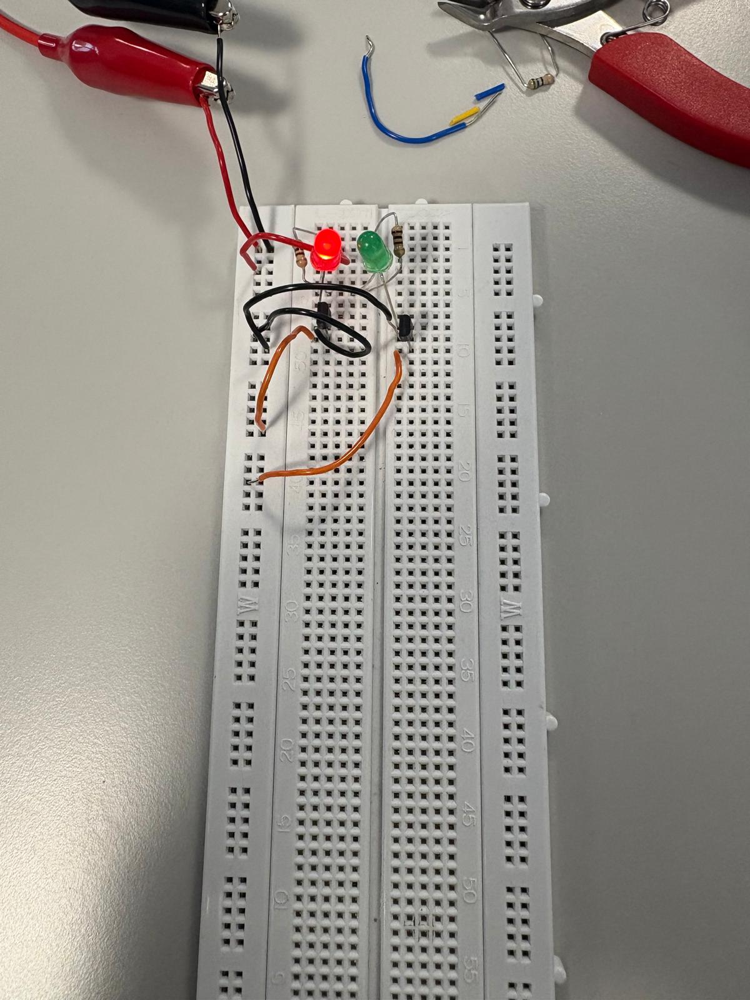
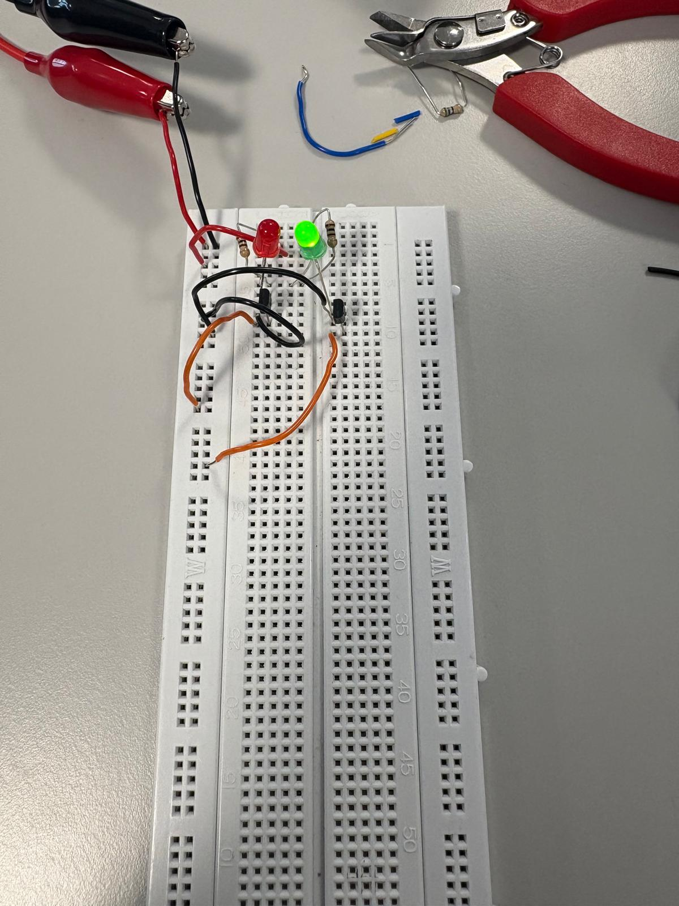
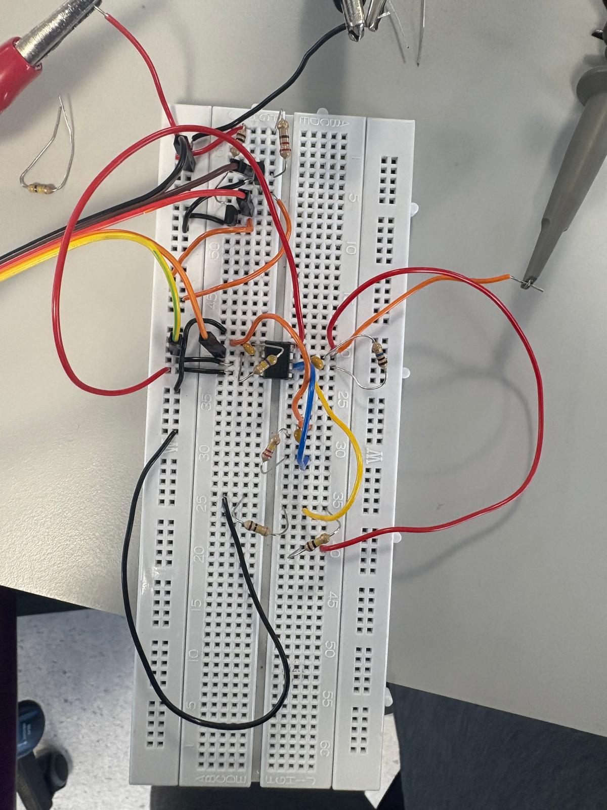
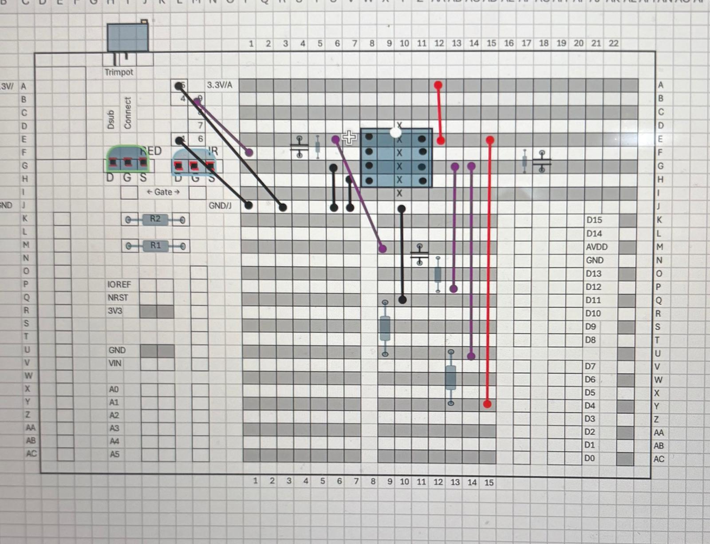
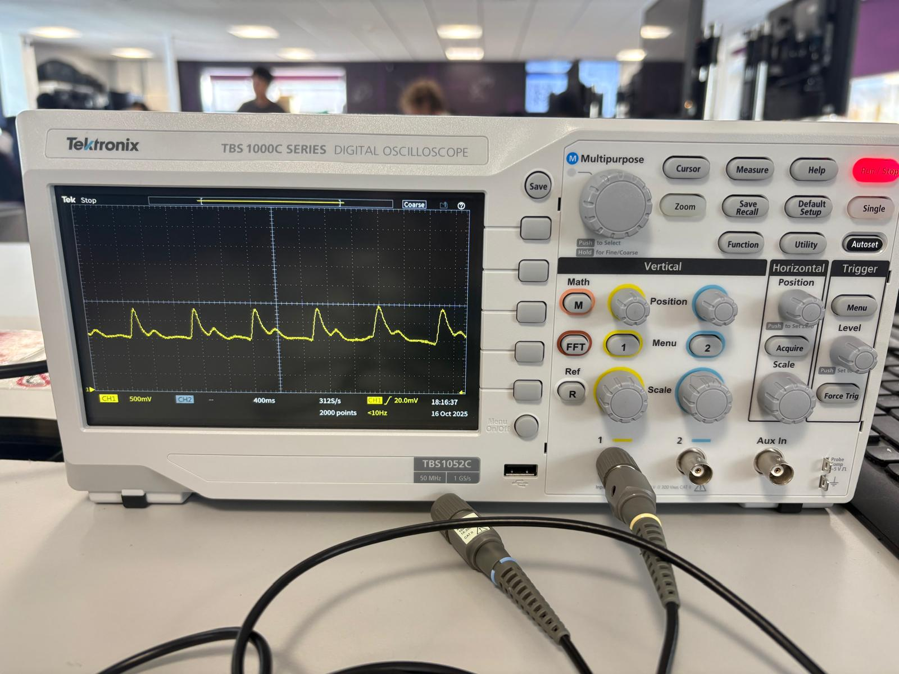
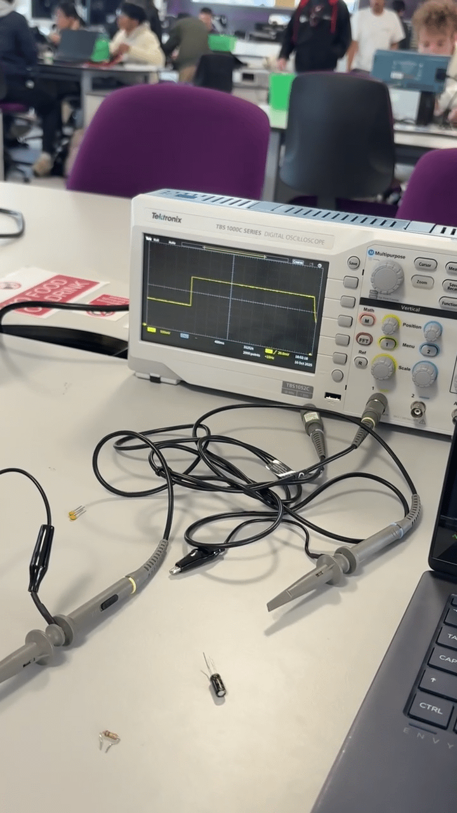
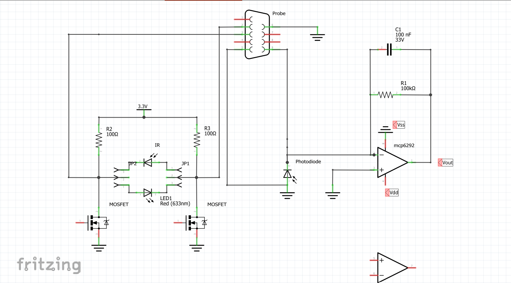

# PPG Pulse Signal Acquisition — Documentation

This folder contains the original circuit layout, editable Fritzing schematic, hardware construction photographs, LED driver testing evidence and oscilloscope recordings from the PPG Pulse Signal Acquisition project.

## 1. LED Driver Circuit — Red LED Test

Initial breadboard testing using a red indicator LED to verify operation of the LED driver switching circuit before connecting the pulse oximeter probe.

## 2. LED Driver Circuit — Green LED Test

Additional testing showing the green indicator LED illuminated, demonstrating operation of the second LED switching path.

## 3. PPG Analogue Circuit — Breadboard Prototype

Photograph of the analogue circuit assembled on a breadboard using the MCP6292 operational amplifier, resistors, capacitors and connecting wires.

The circuit was developed for photodiode signal acquisition and analogue signal conditioning.

## 4. Circuit Layout — Component Placement

Original component placement and wiring layout used to plan the assembly of the analogue circuit onto the prototype PCB.

## 5. PPG Circuit — PCB Implementation

Photograph of the assembled prototype PCB showing the pulse oximeter probe connector, adjustable trimmer resistor, operational amplifier, passive components and connecting wires.

## 6. PPG Waveform — Oscilloscope Capture

Oscilloscope capture showing a repeating PPG waveform with identifiable pulse peaks.

The waveform provides experimental evidence of successful analogue pulse signal acquisition.

## 7. Live PPG Waveform — Oscilloscope Recording

Animated recording of the acquired PPG waveform displayed on the oscilloscope during practical testing.

The recording demonstrates the changing signal over time and the presence of a repeating pulse pattern.

## 8. Fritzing Circuit Schematic

Original Fritzing schematic illustrating the red and infrared LED driver circuits, MOSFET switching stages, pulse oximeter probe connections, photodiode and transimpedance amplifier using the MCP6292 operational amplifier.

### Editable Fritzing Project

[View or download the original Fritzing file](ppg-circuit.fzz)

The original `.fzz` file can be opened and edited using Fritzing software.

## Project Summary

The documented work covers initial LED driver verification, breadboard prototyping, circuit layout planning, PCB assembly and oscilloscope-based PPG signal acquisition.

The photographs, animated recording and editable schematic provide evidence of the practical hardware development, construction and testing process.
