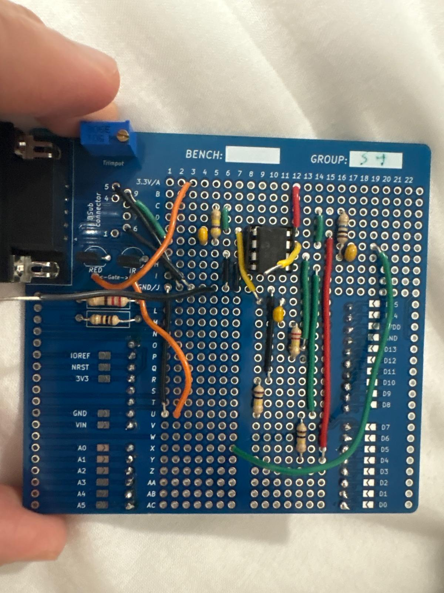

# PPG Pulse Signal Acquisition — Documentation

This folder contains circuit construction photographs, the original circuit layout, an editable Fritzing project, LED driver testing evidence and oscilloscope recordings from the PPG Pulse Signal Acquisition project.

## 1. LED Driver Circuit — Red LED Test

Initial breadboard testing of the LED driver circuit using a red indicator LED to verify switching operation before connecting the pulse oximeter probe.

## 2. LED Driver Circuit — Green LED Test

Additional LED driver testing showing the green indicator LED illuminated, confirming operation of the second switching path.

## 3. PPG Analogue Circuit — Breadboard Prototype

Breadboard construction of the analogue circuit using operational amplifier circuitry, resistors, capacitors and connecting wires for photodiode signal acquisition and conditioning.

## 4. Circuit Layout — Component Placement

Original circuit layout showing planned component positions and interconnections for transferring the analogue circuit onto the prototype PCB.

## 5. PPG Circuit — PCB Implementation

Photograph of the assembled prototype PCB showing the pulse oximeter probe connector, trimmer resistor, operational amplifier, passive components and wiring connections.

## 6. PPG Waveform — Oscilloscope Capture

Oscilloscope capture showing a repeating PPG waveform with clearly identifiable pulse peaks, providing evidence of successful analogue pulse signal acquisition.

## 7. Live PPG Waveform — Oscilloscope Recording

Animated recording of the pulse waveform displayed on the oscilloscope during practical testing, demonstrating the signal's changing behaviour over time.

## 8. Editable Circuit File — Fritzing

[View or download the Fritzing circuit file](ppg-circuit.fzz)

Original editable Fritzing project file supplied for inspecting and modifying the documented circuit layout.

The file can be opened using Fritzing software.

## Project Summary

The documented work covers initial LED driver verification, breadboard prototyping, circuit layout planning, PCB assembly and oscilloscope-based PPG signal acquisition.

The photographs, animated recording and editable circuit file provide supporting evidence of the practical hardware development and testing process.
  
